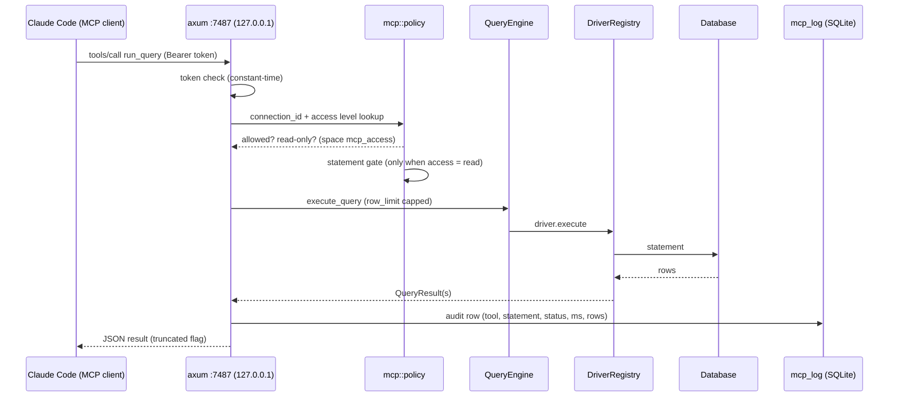

# MCP Server — Design

Expose Larik's saved connections to local AI agents (Claude Code, etc.) over an MCP
server embedded in the running Tauri app, gated by explicit user opt-in at two levels.

Status: **implemented** on branch `feature/mcp-server`. Deviations from the original
design are noted inline (`rmcp` replaced by a hand-rolled JSON-mode server).

## Goals

1. An MCP client on the same machine can discover configured database servers and
   databases, read cached schema, and run queries — using credentials already saved
   in Larik, without the agent ever seeing them.
2. Nothing is exposed by default: a global feature switch plus a per-space access
   level both default to off.
3. Read/write exposure is a per-space decision, enforced as deep in the stack as the
   engine allows (not by trusting the SQL text).
4. Every MCP query is auditable in-app.

## Non-goals

- LAN/remote exposure, OAuth, multi-user auth. Loopback + bearer token only.
- MCP resources, prompts, sampling, elicitation. Tools only.
- ~~GUI approval prompts per query~~ — **implemented (v2) for write access**: every
  `run_query` on a `write` space parks in an approval queue and surfaces a dialog in
  the running app; the MCP call blocks until Approve/Deny or a 2-minute auto-deny.
  Reads stay ungated — server-side read-only enforcement covers them.
- A headless stdio sibling binary (rejected for v1; HTTP-in-GUI chosen).
- SSH tunneling passthrough (Larik has no tunnels today).

## Decisions

| Decision | Choice | Rationale |
|---|---|---|
| Transport | Streamable HTTP inside the running Tauri app — hand-rolled JSON-RPC 2.0 over POST `/mcp` (the spec's JSON response mode, valid for tools-only servers) on `axum`, bound to `127.0.0.1` | ~300 lines fully under test instead of an SDK in flux; no SSE machinery needed; middleware/auth trivially integrated |
| Write policy | Per-space tri-state: `off` / `read` / `write` | Merges "per-connection write opt-in" and "per-space toggle" into one control |
| Global switch | `mcp_enabled` setting, default **off** | Server binds no port unless explicitly enabled |
| Read enforcement | Engine-level where possible; fail-closed statement gate otherwise | Statement sniffing alone is security theater; details per engine below |
| Auth | Bearer token, constant-time compare, no CORS headers | Loopback bind needs no firewall prompt; no CORS = browser JS cannot call it |
| Client onboarding | Settings UI shows a copy-pasteable `claude mcp add` command with real URL + token | The papercut is real; shipping the command is part of the feature |

## Architecture



The HTTP layer shares the existing `AppState` internals (`connections: Arc<ConnectionManager>`,
`query_engine: Arc<QueryEngine>`, `schema_manager: Arc<SchemaMetadataManager>`) — no second
pool layer, no duplicated connection state. `DatabaseManager` (behind its tokio `Mutex`) is
reached for settings, spaces, and the audit log, same as commands do today.

## Access model

Two independent switches:

1. **Global**: `mcp_enabled` in app settings (existing `settings` key-value table via
   `DatabaseManager::set_setting`, same pattern as `max_result_rows`). Off = no listener.
2. **Per space** (a space *is* a saved connection; spaces without `connection_driver` are
   never exposed): new column `mcp_access TEXT NOT NULL DEFAULT 'off' CHECK (mcp_access IN
   ('off','read','write'))` on `spaces`, surfaced in `Space`, `CreateSpaceInput`,
   `UpdateSpaceInput`, and the connection settings UI.

Changing either takes effect immediately: the supervisor starts/stops the listener on
`mcp_enabled` flips; `mcp_access` is read per request.

## Tool surface

Four tools. `connection` = the connection id from `list_connections` (i.e. the saved
connection's id, not the space's display name).

| Tool | Input | Returns |
|---|---|---|
| `list_connections` | – | id, name, driver, host, port, database, mcp access level. **Never credentials.** |
| `list_databases` | connection | `{name, has_access}[]` (existing `DatabaseEntry`) |
| `get_schema` | connection, database, table? | Cached `SchemaInfo` via `SchemaMetadataManager`; `table` narrows to one table's columns (`fetch_table_columns`) |
| `run_query` | connection, query, database?, row_limit? | Result sets or rows-affected; `truncated` flag; `generated_query` for Mongo SQL→pipeline compilation |

`run_query` executes through `QueryEngine::execute_query` — the same path as the Run
button, inheriting statement splitting, cancellation plumbing, and per-driver quirks.

## Enforcement per engine (access level = `read`)

| Engine | Mechanism | Strength |
|---|---|---|
| Postgres | Session-level `default_transaction_read_only = on` applied to sessions serving MCP requests (threaded via an added `ExecuteOptions::read_only`, drivers apply it themselves) | Strong: server rejects writes/DDL |
| MongoDB | Shell-parser allow-list — only read statements (`find`, `aggregate`, `db.*` reads, the SQL SELECT subset which is read-only by construction) | Strong: parser already classifies |
| MSSQL | Fail-closed statement classifier (`mcp/policy.rs`): deny unless confidently a read. Denies: non-SELECT verbs, multi-statement anything non-read, `EXEC`/`sp_*`, `xp_*`, `OPENROWSET`/`OPENQUERY`, `SELECT ... INTO`, unknown parses | **Best-effort** |

MSSQL has no session-level read-only. Residual risk (documented, not hidden): exotic
T-SQL that the classifier misjudges. Users who need a hard guarantee use a read-only
login for that connection — the UI copy says so. `write` mode removes the gate for that
space entirely; the saved login's own permissions are then the only boundary.

Fail-closed principle: when the classifier cannot prove a statement is a read, the
statement is refused with the access level in the error message.

## Limits and timeouts

- Row cap: MCP default **200** rows/result set, hard max **1000** (mirrors the existing
  `reference_preview_row_limit` 1..=1000 validation shape); `row_limit` requested above
  the max is clamped, never errors. Reuses `ExecuteOptions::row_limit` / `ResultSet::truncated`.
- Statement timeout: hard cap 120s per statement (v1 constant); on timeout the existing
  cancel plumbing is triggered so work stops server-side.
- Response size guard: serialized result capped (~1 MiB) — truncate rows until under,
  set `truncated`. Prevents one wide-table query from eating the agent's context.

## Auth and network posture

- Bind `127.0.0.1:7487` (port overridable via `mcp_port` setting; bind failure surfaces
  in the GUI, no silent fallback — a silent random port would strand the client config).
- Bearer token: 32 hex chars, generated on first enable, stored in settings (`mcp_token`).
  Plaintext in the same SQLite as connection passwords — no new threat boundary. Regenerate
  button in settings UI.
- Constant-time token compare; 401 with no detail on mismatch; no CORS headers emitted
  (browser-origin requests fail outright); loopback bind → no Windows Firewall prompt.

## Audit

New `storage/mcp_log.rs` → table `mcp_log`: `id, ts, tool, connection_id, space_name,
statement (truncated 10k), access_level, status ('ok'|'error'|'denied'), duration_ms,
rows_returned`. Written for every tool call including denials (denials record the reason).
UI: read-only log view under Settings → MCP (reuse the archive/history list patterns).

## Code touchpoints

| Area | Change |
|---|---|
| `src-tauri/src/mcp/` (new) | `mod.rs` (supervisor: start/stop listener on toggle), `server.rs` (axum + rmcp streamable HTTP service, auth middleware), `tools.rs` (the four tools), `policy.rs` (access lookup, MSSQL classifier, statement gate) |
| `src-tauri/src/db/driver.rs` | `ExecuteOptions` gains `read_only: bool`; postgres driver applies session RO |
| `src-tauri/src/db/postgres/` | Apply `SET default_transaction_read_only` when `options.read_only` |
| `src-tauri/src/storage/spaces.rs` | `mcp_access` column (migration in `database.rs` alongside existing `ALTER TABLE spaces` pattern), struct fields |
| `src-tauri/src/storage/` | `mcp_log.rs` (new); `state.rs` settings accessors for `mcp_enabled` / `mcp_port` / `mcp_token` |
| `src-tauri/src/commands.rs` | `AppState` gains `mcp: Arc<McpSupervisor>`; commands: get/set mcp settings, regenerate token, list mcp log |
| `src-tauri/src/lib.rs` | Construct supervisor in `run()`, spawn listener in `.setup` when enabled |
| Frontend `src/` | Settings section "MCP Server" (enable toggle, port, token reveal/copy, ready-made `claude mcp add` command, log view); connection settings tri-state per space; `types/` + `api/` additions |

New Cargo deps: `axum` only. The bearer-token compare is an inline constant-time
XOR-fold (`ct_eq` in `mcp/server.rs`) — no `subtle` dependency.

## Client onboarding

Settings UI renders (with real values):

```
claude mcp add larik --transport http http://127.0.0.1:7487/mcp \
  --header "Authorization: Bearer <token>"
```

## Testing

- Unit: classifier fail-closed matrix (CTE-INSERT, trailing `;DELETE`, `xp_cmdshell`,
  `SELECT INTO`, dynamic `EXEC`, unicode/semicolon-in-string cases), access-level gating,
  row-cap clamping.
- Live: `LARIK_TEST_MONGODB_URL`-style env-gated tests for Postgres read-only enforcement
  (`read_only` blocks DDL server-side while reads keep working).
- Integration: raw-socket HTTP tests in `mcp/server.rs` against the axum service on an
  ephemeral port — initialize, tools/list, notifications → 202, unknown method → -32601,
  GET → 405, token mismatch → 401.
- Smoke: real dev build exercised end-to-end (401 paths, initialize, tools/list,
  live SELECT via MSSQL, classifier denials, exposure refusals, audit rows).

## Implementation notes (answers to the original open questions)

1. **rmcp → hand-rolled.** The streamable-HTTP spec's JSON response mode covers the
   tools-only surface (POST JSON-RPC, JSON reply; notifications → 202; GET/DELETE → 405;
   unknown method → -32601; no session id = stateless). No SSE, no SDK API roulette.
2. **Postgres read-only placement.** `execute` always runs on a dedicated connection
   (`connect_dedicated`), so `default_transaction_read_only=on` rides the startup
   `options` parameter — race-free by construction, drop-safe (the session dies with
   the future).
3. **MSSQL batch classification.** Each driver-split unit is classified independently
   (`mssql_read_allowed`); a unit's semicolon-separated parts are judged separately, so
   `SELECT 'x'; DELETE …` is denied without blanket-banning batches on engines that have
   real enforcement. Audit rows distinguish `denied` (policy) from `error` (execution)
   via `ToolFail`.

## v2 — approval gateway (implemented)

Spaces exposed with `write` access hand the saved login's own permissions to the agent.
To keep a human in the loop, every `run_query` on such a space is gated:

- `mcp/approvals.rs` parks the request (`ApprovalRequest` = id, connection, space,
  driver, statement truncated to 4k chars) and surfaces it to the frontend via the
  `mcp-approval-request` Tauri event. The MCP request blocks on a oneshot channel.
- `McpApprovalDialog` (mounted at the app root) listens, queues requests, shows the
  statement, and calls `respond_mcp_approval(id, approved)`; it rehydrates from
  `get_pending_mcp_approvals` on mount.
- Outcomes: **approved** → execution proceeds (audited `ok`/`error`); **denied** →
  `ToolFail::deny` (audited `denied`); **timeout** (2 min, `APPROVAL_TIMEOUT`) →
  auto-deny, queue entry removed (audited `denied`).
- Reads (`read` spaces) skip the gate — they are enforced read-only server-side, and
  the user opted them in deliberately. `list_connections`/`list_databases`/`get_schema`
  are never gated.

Build note (Windows): test harnesses link the tauri runtime and would import
`TaskDialogIndirect` (Common-Controls **v6**) — without an embedded manifest the
harness fails to load with `STATUS_ENTRYPOINT_NOT_FOUND`. tauri-build embeds its
manifest for bins only, so `build.rs` disables that
(`WindowsAttributes::new_without_app_manifest`) and passes the identical
`windows-app-manifest.xml` to every target via `/MANIFEST:EMBED /MANIFESTINPUT`.
